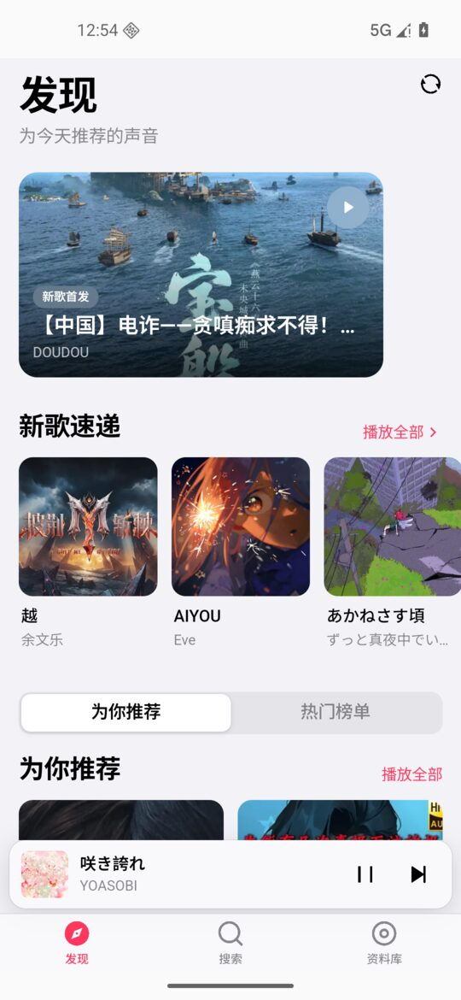

<h1 align="center">Biu for Android</h1>

<p align="center">
  
</p>

<p align="center">
  基于哔哩哔哩（B 站）公开接口的 Android 音乐播放器<br />
  <b>Biu for Phone</b> · <b>Biu for Pad</b>
</p>

<p align="center">
  <a href="../../releases/latest"></a>
  <a href="LICENSE"></a>
  
</p>

<p align="center">
  非官方项目，与哔哩哔哩（B 站）无任何官方关联或背书
</p>



---

## 下载

安装包发布在 [Releases](../../releases/latest)：

| 应用 | 适用设备 | 包名 | 安装包 |
| --- | --- | --- | --- |
| **Biu for Phone** | 手机 | `com.biu.music.phone` | `Biu-for-Phone-0.2.1.apk` |
| **Biu for Pad** | 平板 / 折叠屏 | `com.biu.music.pad` | `Biu-for-Pad-0.2.1.apk` |

两个安装包使用同一张证书签名，可直接覆盖安装同一应用的新版本；手机版与平板版包名不同，可以同时安装。

> **从 1.16.0 升级**：请先卸载旧版。0.2.0 起 WebView 的 origin 从 `https://localhost` 改为 `http://localhost`（为了允许本地音频中继），旧版本地数据不会迁移。卸载只会丢失本机播放队列、搜索历史和登录状态。

---

## 功能

- 发现页：新歌速递、热门榜单、为你推荐、分区浏览
- 搜索：综合 / 视频 / 用户 / 专栏，支持搜索历史
- 播放：队列、随机 / 单曲循环 / 列表循环、倍速、进度拖动、定时关闭
- **边下边播**：本地回环中继直连 B 站音频 CDN，点按后通常 0.1–0.7 秒出声，不再等整首歌下载完
- 歌词：逐行滚动、点击跳转、全屏歌词
- 资料库：收藏夹、稍后再看、历史记录、本地歌单
- 账号：扫码登录、Cookie 持久化、游客 Cookie 自动补齐
- 系统集成：MediaSession、通知栏控制、耳机线控、锁屏播放、后台播放
- 设置：浅色 / 深色 / 跟随系统、播放诊断、缓存管理

---

## 两个版本，一套源码

项目只有一份代码，通过 Gradle product flavor 产出两个应用：

| 项目 | Biu for Phone | Biu for Pad |
| --- | --- | --- |
| 包名 | `com.biu.music.phone` | `com.biu.music.pad` |
| 界面外壳 | 底部 Tab 栏 + MiniPlayer | 左侧边栏 + 右侧「正在播放」面板 |
| 图标 / 启动图 | `mobile/android/app/src/phone/res/` | `mobile/android/app/src/pad/res/` |
| 网页产物 | `mobile/dist/phone` | `mobile/dist/pad` |
| 构建命令 | `pnpm mobile:apk:phone` | `pnpm mobile:apk:pad` |
| 输出 | `mobile/android/app/build/outputs/apk/phone/release/app-phone-release.apk` | `mobile/android/app/build/outputs/apk/pad/release/app-pad-release.apk` |

平板外壳需要至少 720px 宽度，窗口更窄时会退回手机外壳。

---

## 本地构建

### 环境要求

| 依赖 | 版本 |
| --- | --- |
| Node.js | ≥ 22.17.1（见 `.nvmrc`） |
| pnpm | 10.x（见 `package.json` 的 `packageManager`） |
| JDK | 21 |
| Android SDK | Platform 36、Build-Tools 36.0.0 |
| Gradle | 使用仓库自带的 wrapper，无需单独安装 |

> 没有 pnpm 时先执行 `corepack enable`（Node 自带），或 `npm i -g pnpm@10`。

### 构建

```bash
pnpm install

# 手机版
pnpm mobile:apk:phone

# 平板版
pnpm mobile:apk:pad
```

只调试网页层（浏览器预览）：

```bash
pnpm mobile:dev
# http://localhost:5178/__preview.html?w=390&h=844&ui=phone
```

### 签名

发布包必须签名。把 keystore 放到 `mobile/android/keystore/`，并创建 `mobile/android/keystore.properties`：

```properties
storeFile=keystore/biu-release.jks
storePassword=你的仓库口令
keyAlias=biu
keyPassword=你的密钥口令
```

没有这些文件时 Gradle 会产出**未签名**的 release 包。`keystore.properties`、`*.jks`、`local.properties` 已在 `.gitignore` 中排除，**永远不要提交**。

> 同一个包名的后续版本必须使用同一张证书签名，否则用户只能卸载重装。请把 keystore 和口令备份到安全位置。

---

## 项目结构

```
.
├── mobile/                     Android 工程（本项目的主要开发目录）
│   ├── src/                    移动端 React 代码
│   │   ├── pages/              发现 / 搜索 / 资料库 / 设置等页面
│   │   ├── components/         布局、播放器、列表、Sheet、通用控件
│   │   ├── store/              播放器、UI、设置等状态
│   │   ├── lib/                HTTP、Cookie、主题、歌词、音频中继等
│   │   └── api/                移动端数据层
│   ├── android/                Capacitor Android 工程（phone / pad flavor）
│   ├── scripts/                图标生成、产物分发脚本
│   ├── capacitor.config.ts
│   └── vite.config.ts
├── src/                        桌面端 Biu 源码（移动端只读复用）
├── shared/                     桌面端与移动端共享类型 / 工具
├── electron/                   桌面端 Electron 主进程
├── docs/                       文档与截图
├── scripts/                    发布辅助脚本
├── README.desktop.md           桌面版原 README
└── .github/workflows/          CI 与 GitHub Release 自动化
```

移动端通过 Vite alias 直接复用桌面端的 `src/service`、`src/common/utils` 与 `shared/`，并用 `mobile/src/shims` 替换 Electron / HeroUI 等桌面专属依赖。

更多移动端实现细节见 [`mobile/README.md`](./mobile/README.md)。

---

## 实现要点

- **壳层**：Capacitor 8 把 Vite 构建的 React 19 单页应用装进原生 WebView，只保留一个 Activity，前端路由与原生返回键联动。
- **音频**：B 站音频 CDN 会拒绝 WebView 与 okhttp 的 UA（403），响应类型还是 `application/octet-stream`，会被 Chromium 的 ORB 拦截。原生端启动了一个只监听 `127.0.0.1` 的本地 HTTP 中继（`BiliStreamServer.java`），由它携带桌面 UA 与 `Referer` 请求 CDN，并原样转发 `Range`；`<audio>` 播放本地中继地址，因此可以边下边播与拖动进度。
- **兜底**：中继不可用时自动退回「整段下载为 Blob」方案，并根据播放错误自动重新解析音源。
- **状态栏**：安全区优先读取 Capacitor 注入的 `--safe-area-inset-*`，`env()` 仅作回退；全屏播放器的返回 / 更多按钮始终位于系统状态栏下方且同高。
- **游客风控自愈**：解析失败时自动清空游客 Cookie 并重新引导一次（10 分钟内最多一次，登录用户不受影响）。

---

## 版本规则

当前项目版本统一为 **0.2.1**，在大版本稳定前不会到 1：

- 根目录 `package.json` 与 `mobile/package.json` 的 `version`：均为 `0.2.1`（界面「设置 → 关于 → 版本」读取后者）
- `mobile/android/app/build.gradle` 的 `versionName`（同号）与 `versionCode`（必须递增，当前 `12001`）

每发一版三处同时改：小修 `+0.0.1`（versionCode +1），功能更新 `+0.1.0`（versionCode +100）。

发版流程见 [`docs/GITHUB.md`](./docs/GITHUB.md)。

---

## 许可证与商用

本项目基于 [wood3n/biu](https://github.com/wood3n/biu) 二次开发，沿用上游的
**[PolyForm Noncommercial License 1.0.0](./LICENSE)**。

- ✅ 个人学习、研究、实验、私人娱乐、业余项目
- ✅ 查看、修改、分发源码（需保留许可证与 `Required Notice`）
- ❌ **任何商业用途**，包括销售、付费分发、商业产品集成、以本项目提供商业服务等
- ❌ 不得移除或替换许可证、版权声明

需要商用授权时，请先联系项目维护者 [@huts1234](https://github.com/huts1234) 单独获取**商业许可**。

> **关于“开源”的说明**：PolyForm Noncommercial 1.0.0 属于 **source-available（源码公开）** 许可证，不是 OSI 定义的 open source license——OSI 开源许可证不允许限制商业用途。如果你坚持使用 OSI 开源许可证，就必须允许他人商用；在这种场景下通常选择 **AGPL-3.0**（强 copyleft，但仍允许商用），而不是“禁止商用”的协议。
>
> 由于上游 Biu 已经是 PolyForm Noncommercial 1.0.0，本衍生项目**必须继续沿用该许可证**，不能改成更宽松或允许商用的协议。

---

## 致谢

- 桌面版原作者：[wood3n](https://github.com/wood3n) 与 [Biu](https://github.com/wood3n/biu) 的所有贡献者
- [Capacitor](https://capacitorjs.com/)、[React](https://react.dev/)、[Vite](https://vite.dev/)、[Remixicon](https://remixicon.com/)

---

## 免责声明

- 本项目为非官方项目，与哔哩哔哩（B 站）没有任何官方关联或背书。
- 所有数据与音频均来自哔哩哔哩公开接口，版权归哔哩哔哩及原 UP 主所有，仅供学习与个人使用。
- 请遵守哔哩哔哩的用户协议与相关法律法规，不要将本项目用于商业用途或大规模抓取。
